  <picture>
    <source media="(prefers-color-scheme: dark)" srcset="assets/banner-dark.svg" />
    
  </picture>

  <b>회사 경력 1년 11개월 · 외주 개발 3건 · 개인 서비스 운영</b>

  
  

 

## About

병동 모니터링 화면을 개발하며, 화면 갱신이 늦거나 값이 어긋나는 문제가 서버 API와 데이터 흐름에 연결되어 있다는 걸 알게 됐습니다. 네트워크 요청과 데이터가 흐르는 경로를 따라가며 문제를 해결하다 보니 서버 개발에도 관심이 생겼습니다. 이후 Node.js와 NestJS를 공부하고, 외주 프로젝트에서 고객 관리와 알림 자동화 기능을 직접 만들었습니다.

## Projects

### 옆집 강아지

   

동네 반려인과 산책 친구를 이어 주는 서비스입니다. 기획과 디자인부터 서버와 화면 개발, 배포와 운영까지 혼자 맡았습니다.

같은 이웃에게 산책 요청을 동시에 보내면 요청이 두 개 생길 수 있었습니다. 그래서 "두 사람 사이에 대기 중인 요청은 하나만"이라는 규칙을 DB 제약(부분 유니크 인덱스)으로 걸었습니다. 코드가 아니라 DB가 막기 때문에, 요청이 동시에 들어와도 하나만 남습니다.

  
  

- PostGIS로 1km 안의 이웃을 거리순으로 찾습니다.
- 산책 요청이 수락된 두 사람만 Socket.IO 채팅을 이용할 수 있습니다.
- 집 데스크톱의 Ubuntu Server에 Docker Compose로 배포하고, HTTPS, DB와 사진 백업, 업데이트 스크립트까지 직접 구성해 운영합니다.

`Node.js` `NestJS` `PostgreSQL/PostGIS` `Socket.IO` `Next.js` `Docker Compose`

### Code Learning

 

처음 보는 TypeScript와 JavaScript 프로젝트를 실제 코드와 줄 위치를 따라 이해하는 읽기 전용 데스크톱 앱입니다.

화면에서 요청을 보내 서버가 처리하고 DB에 닿기까지의 흐름과, 파일끼리 코드를 불러오는 import 관계를 보여 줍니다. 파일을 수정하거나 코드를 실행하지 않고 연결의 근거가 되는 파일과 줄을 표시하며, 불확실한 연결은 ‘추정’으로 구분합니다. 필요하면 AI로 함수나 파일의 설명, 기획과 구현의 비교 내용을 확인하고 근거 코드로 이동할 수 있습니다.

`Electron` `React` `TypeScript` `Tree-sitter`

### Client Review

 

외주 개발자가 올린 화면 사진 위에 클라이언트가 수정 요청을 남기고, 지정된 승인자가 버전을 승인하는 검수 서비스를 만들고 있습니다.

현재는 **NestJS, React, Prisma 기본 구조와 Docker 실행 환경을 갖춘 초기 단계**입니다. 화면별 피드백과 버전 승인 흐름을 구현하는 것이 목표입니다.

`NestJS` `React` `PostgreSQL` `Prisma` `Docker Compose`

 

## Experience

### 외주 개발 · 단독 개발 및 배포

(주)제이에이 솔루션의 고객지원과 사내 업무를 위한 서비스를 만들었습니다.

| 기간 | 프로젝트 | 한 일 | 기술 |
| --- | --- | --- | --- |
| 2026.06 – 07 | **고객지원 서비스** | 복합기 드라이버·영상 안내, 관리자 자료·다운로드 통계 | Next.js · Supabase · Netlify |
| 2025.08 | **알림·업무 자동화** | monday.com 상태 변경 시 문자·카카오톡 발송, 고객 명단 정리 | Node.js · Express · Apps Script |
| 2025.03 | **사내 수리 이력 공유** | 수리 내역·사진·영상과 직원 댓글 공유 | React · Cloudflare |

### 모어다임 · 프론트엔드 개발

**2024.08 – 2026.06 · 연구소 개발팀**

CARE 의료 병동 모니터링 시스템의 프론트엔드를 개발하고 유지보수했습니다.

- React와 TypeScript로 Dashboard, Actingboard, Tableboard를 만들었습니다. WebSocket으로 처음에는 전체 데이터를 받고, 이후에는 변경된 데이터를 화면에 반영했습니다.
- 환자와 침상 배정, 환자 상세, 장치 연결 상태와 알림, 의료 리포트와 관리자 설정 화면을 구현했습니다.
- TanStack Query와 Axios로 서버 데이터를 연동하고, 의료 데이터 타입과 예외 처리를 개선했습니다.

[실무 경험 자세히 보기 →](https://changhyon.dev/#work)

 

## Tech Stack

| 영역 | 사용하는 기술 |
| --- | --- |
| **Backend** |       |
| **Data** |     |
| **Test & Deploy** |     |
| **Frontend** |      |
| **Desktop** |   |
