  

  API·데이터베이스·실시간 통신을 구현하고, 
  프론트엔드 개발부터 배포·운영까지 직접 맡습니다.

  <b>회사 경력 1년 11개월 · 외주 개발 3건 · 개인 서비스 운영</b>

  
  

 

## 🚀 Projects

### 🐶 옆집 강아지

 · 개인 프로젝트 · [서비스 둘러보기](https://dogwalk.changhyon.dev) · [GitHub](https://github.com/ckdgus222/Dog-walk)

동네 반려인과 산책 친구를 이어 주는 서비스로, **기획·디자인부터 백엔드·프론트엔드 개발, 배포·운영까지 혼자 진행**했습니다.

  
  

- **API·위치 검색:** NestJS·Prisma로 API를 만들고, PostgreSQL·PostGIS로 1km 안의 이웃을 거리순으로 찾습니다.
- **동시 요청 처리:** 같은 두 사람의 대기 중인 산책 요청은 DB 제약으로 하나만 허용하고, 반려견 삭제·사진 교체는 DB 잠금으로 보호합니다.
- **인증·실시간 통신:** 로그인 인증과 산책 요청이 수락된 두 사용자만 대화하는 Socket.IO 채팅을 구현했습니다.
- **배포·운영:** 집 데스크톱의 Ubuntu Server에 Docker Compose로 배포하고, HTTPS·DB 및 사진 백업·업데이트 스크립트를 구성했습니다.
- **프론트엔드 연결:** Next.js로 지도·채팅·일기·게시판을 만들고, 계정별 TanStack Query 캐시 분리로 이전 사용자 정보 노출을 막았습니다.

`Node.js` `NestJS` `PostgreSQL/PostGIS` `Socket.IO` `Next.js` `Docker Compose`

### 🔎 Code Learning

 · [GitHub](https://github.com/ckdgus222/code-learning)

처음 보는 TypeScript·JavaScript 프로젝트를 **실제 코드와 줄 근거를 따라 이해하는 읽기 전용 데스크톱 앱**입니다.

- **코드 탐색:** 화면 → 요청 → 서버 처리 → DB로 이어지는 기능 흐름과 파일 사이의 import 관계를 보여 줍니다.
- **근거 확인:** 파일 수정·코드 실행 없이 연결의 실제 파일·줄을 표시하고, 불확실한 연결은 ‘추정’으로 구분합니다.
- **AI 설명:** 선택적으로 함수·파일 설명과 기획 대비 구현 내용을 확인하고, 설명의 근거 코드로 이동합니다.

`Electron` `React` `TypeScript` `Tree-sitter`

### 📝 Client Review

 · [GitHub](https://github.com/ckdgus222/client-review)

외주 개발자가 올린 화면 사진 위에 클라이언트가 수정 요청을 남기고, 지정된 승인자가 버전을 승인하는 검수 서비스를 만들고 있습니다.

현재는 **NestJS·React·Prisma 기본 구조와 Docker 실행 환경을 갖춘 초기 단계**입니다. 화면별 피드백과 버전 승인 흐름을 구현하는 것이 목표입니다.

`NestJS` `React` `PostgreSQL` `Prisma` `Docker Compose`

 

## 💼 Experience

### 외주 개발 · 단독 개발 및 배포

(주)제이에이 솔루션의 고객지원과 사내 업무를 위한 서비스를 만들었습니다.

| 기간 | 프로젝트 | 한 일 | 기술 |
| --- | --- | --- | --- |
| 2026.06 – 07 | **고객지원 서비스** | 복합기 드라이버·영상 안내, 관리자 자료·다운로드 통계 | Next.js · Supabase · Netlify |
| 2025.08 | **알림·업무 자동화** | monday.com 상태 변경 시 문자·카카오톡 발송, 고객 명단 정리 | Node.js · Express · Apps Script |
| 2025.03 | **사내 수리 이력 공유** | 수리 내역·사진·영상과 직원 댓글 공유 | React · Cloudflare |

### 모어다임 · 프론트엔드 개발

**2024.08 – 2026.06 · 연구소 개발팀**

CARE 의료 병동 모니터링 시스템의 프론트엔드를 개발하고 유지보수했습니다.

- **실시간 관제:** React·TypeScript로 Dashboard·Actingboard·Tableboard를 만들고, WebSocket의 초기 전체·이후 변경 데이터를 반영했습니다.
- **현장 업무 화면:** 환자·침상 배정, 환자 상세, 장치 연결 상태·알림, 의료 리포트·관리자 설정 화면을 구현했습니다.
- **API 연동:** TanStack Query·Axios로 서버 데이터를 연동하고, 의료 데이터 타입과 예외 처리를 개선했습니다.

[실무 경험 자세히 보기 →](https://changhyon.dev/#work)

 

## 🛠 Tech Stack

| 영역 | 사용하는 기술 |
| --- | --- |
| **Backend** |       |
| **Data** |     |
| **Test & Deploy** |     |
| **Frontend** |      |
| **Desktop** |   |
